# Manual técnico completo de Archaios ABM-GROUP

## 1. Alcance

Archaios es una aplicación Java por consola organizada en paquetes de dominio, operaciones de menú, persistencia, comunicación y utilidades. El sistema permite gestionar arqueólogos, licencias y habilidades, consultar regiones y tesoros, mantener estadísticas, realizar excavaciones y guardar o enviar los resultados.

El manual describe la arquitectura real del proyecto y todas las clases y enumeraciones principales. Las tablas mantienen una explicación concisa por componente.

## 2. Arquitectura general

`preInit()` registra regiones y habilidades y carga los tesoros. `init()` carga o crea una partida. `run()` presenta las operaciones del menú y `end()` finaliza la ejecución. Las operaciones usan `IOperation` para compartir el contrato de nombre y ejecución.

## 3. Diagrama general de clases

```mermaid
classDiagram
  Archaios *-- Stats
  Archaios o-- Archeologist
  Archaios o-- Zeraf
  Archaios --> IOperation
  Archaios --> RegionRepository
  Archaios --> SkillRepository
  Archaios --> SaveManager
  IOperation <|.. ArcheologistsOperation
  IOperation <|.. AtlasOperation
  IOperation <|.. CatalagoTesoros
  IOperation <|.. ExcavateOperation
  IOperation <|.. LicenseOperation
  IOperation <|.. SkillsOperation
  IOperation <|.. StatsOperation
  Region <|-- RegionDificil
  RegionDificil ..|> IRegionDificil
  RegionDificil <|-- Egypt
  RegionDificil <|-- Petra
  RegionDificil <|-- Sumeria
  Region <|-- Greece
  Region <|-- Iberia
  Region <|-- Rome
  Excavation *-- RejillaExcavacion
  Excavation o-- ETerrainSize
  Excavation o-- Region
  Excavation o-- Archeologist
  Excavation --> ExcavationConsoleUI
  Skill <|-- Conocimiento
  Skill <|-- Escaneo
  Skill <|-- Especialista
  Skill <|-- Excavaciones
  Skill <|-- Experiencia
  Skill <|-- Extra
  Skill <|-- Investigacion
  Skill <|-- Licencia
  Skill <|-- Limpieza
  Skill <|-- TerrenoDemoler
  Skill <|-- TerrenoEspecializacion
  TerrenoEspecializacion <|-- TerrenoArena
  Zeraf --> IMessageWrapper
  Zeraf --> ResponseWrapper
```

## 4. Paquete `commons`

Coordina el arranque de la aplicación, la persistencia y los adaptadores de serialización.

| Clase | Responsabilidad |
| --- | --- |
| `Archaios` | Clase principal. Guarda en el JSON el UID, el nombre, los puntos, los arqueólogos y las estadísticas (las operaciones y Zeraf son `transient` y no se guardan). Inicializa, ejecuta y finaliza el menú. |
| `RegionAdapter` | Adapta `Region` a GSON mediante su nombre y la restaura buscando por nombre o código en `RegionRepository`. |
| `SaveManager` | Guarda, carga y lista las partidas JSON `.save` en UTF-8. Los errores los escribe con `Registro`. |
| `SkillAdapter` | Adapta `Skill` a GSON mediante su nombre y la restaura buscando coincidencias en `SkillRepository`. |

## 5. Paquete `commons.operations`

Implementa las opciones del menú principal. Todas las operaciones cumplen `IOperation`.

| Clase | Responsabilidad |
| --- | --- |
| `IOperation` | Contrato común con `getName()` y `operation()` para registrar y ejecutar opciones del menú. |
| `ArcheologistsOperation` | Lista, contrata, licencia o gestiona arqueólogos y guarda la partida cuando cambia su estado. |
| `AtlasOperation` | Consulta las regiones disponibles y presenta sus tesoros, indicando las regiones difíciles y su expansión. |
| `CatalagoTesoros` | Muestra el catálogo de tesoros y permite consultar la ficha detallada de uno concreto. |
| `ExcavateOperation` | Selecciona arqueólogo, región y terreno; ejecuta la excavación y registra, envía y recompensa los resultados. |
| `LicenseOperation` | Compra licencias para regiones difíciles según el coste acumulado y las licencias ya adquiridas. |
| `SkillsOperation` | Consulta tipos y habilidades, mostrando descripciones, dependencias e incompatibilidades. |
| `StatsOperation` | Ofrece los modos de consulta de estadísticas por lugares, regiones y tipos de tesoros. |

## 6. Paquete `commons.repositories`

Mantiene catálogos únicos creados durante la inicialización.

| Clase | Responsabilidad |
| --- | --- |
| `RegionRepository` | Registra las seis regiones y permite buscar todas las regiones, por código o tesoro, y separarlas en básicas y difíciles. |
| `SkillRepository` | Crea y registra las habilidades, sus dependencias y catálogo por tipo o nombre. Incluye habilidades base y de expansión disponibles. |

## 7. Paquete `regions`

Modela regiones, tesoros cargados y regiones con terrenos especiales.

| Clase/enum/interfaz | Responsabilidad |
| --- | --- |
| `Region` | Clase abstracta con nombre, código y colección de tesoros; filtra y busca tesoros por código, tipo o rareza. |
| `IRegionDificil` | Interfaz que expone las proporciones de terreno y la expansión asociada a una región difícil. |
| `RegionDificil` | Base abstracta que almacena expansión y mapa de proporciones de terrenos. |
| `RegionLoader` | Carga los tesoros desde `data/regions/<CODIGO>.json` en UTF-8 y registra la carga fallida. |
| `TreasureData` | DTO que representa los campos de un tesoro dentro del JSON antes de convertirlo en `Treasure`. |
| `Greece` | Región básica GRC con tesoros cargados desde datos externos. |
| `Iberia` | Región básica IBR con tesoros cargados desde datos externos. |
| `Rome` | Región básica ROM con tesoros cargados desde datos externos. |
| `Egypt` | Región difícil EGP: 10 % agua, 35 % tierra y 55 % arena. |
| `Petra` | Región difícil PTR: 75 % piedra y 25 % arena. |
| `Sumeria` | Región difícil SUM: 30 % piedra, 50 % arena y 20 % tierra. |

## 8. Paquete `excavation`

| Clase/enum | Responsabilidad |
| --- | --- |
| `Excavation` | Fachada de la partida: valida acceso, crea tablero y tesoros, controla acciones, posiciones, puntos y experiencia. |
| `ExcavationConsoleUI` | Interfaz por consola que muestra turnos, lee coordenadas, procesa errores y presenta el resumen final. |
| `RejillaExcavacion` | Estado de la cuadrícula, terreno por casilla, símbolos visibles, suposiciones, casillas resueltas y coordenadas. |
| `ExcavationSetupHelper` | Coloca tesoros y aplica demoliciones, limpieza y escaneo antes de comenzar el turno. |
| `TerrainHelper` | Reparte proporciones regionales por el método del resto mayor y rellena regiones básicas con tierra. |
| `ETerreno` | Tipo de casilla: tierra, piedra, arena o agua, con símbolo, coste y posible siguiente nivel. |
| `ETerrainSize` | Configuración disponible: filas, columnas, tamaño, nombre, nivel mínimo y forma cuadrada o lineal. |
| `TerrainShape` | Forma geométrica: cuadrado, fila, columna, horizontal o vertical. |
| `TerrainSize` | Tamaño básico: pequeño, mediano o grande. |
| `Position` | Coordenada formada por fila numérica y columna alfabética. |

Las regiones básicas generan todo su tablero con tierra. Las difíciles usan proporciones configuradas. Un terreno con siguiente nivel, como piedra, pasa a tierra al excavarse y obliga a excavar nuevamente la posición.

## 9. Paquete `logs`

| Clase | Responsabilidad |
|---|---|
| `Registro` | Clase final de métodos estáticos que escribe inicio y tesoros por partida en `log/register/<partida>.log`, y excepciones con pila en `log/errors.log`. |

Las líneas llevan `[yyyy-MM-dd HH:mm:ss]`. Los archivos se crean bajo demanda y los fallos de escritura no deben interrumpir la partida.

## 10. Paquete `people`

| Clase | Responsabilidad |
|---|---|
| `Archeologist` | Representa nivel, experiencia, habilidades, licencias, especialización y formas desbloqueadas. Comprueba acceso a regiones y terrenos y suma los bonos de habilidades. |

Los niveles van de 0 a 5. El tamaño pequeño está disponible desde el inicio; mediano desde el nivel 2 y grande desde el 4. La experiencia acumulada puede producir varios niveles y aplica bonos de especialización en nivel máximo.

## 11. Paquete `skills`

| Clase/enum | Responsabilidad |
| --- | --- |
| `ESkillType` | Tipo legible de habilidad: tesoro, excavación, terreno o especialista. |
| `Skill` | Base abstracta de todas las habilidades; contiene nombre, descripción, tipo, dependencias e incompatibilidades, y bonos neutros sobrescribibles. |
| `Conocimiento` | Bonifica tesoros de rarezas específicas: Aprendiz, Experto y Maestro. |
| `Escaneo` | Inicialmente marca casillas con `?`: Escaneo A, B, C y D. |
| `Especialista` | Incrementa probabilidades de rareza infrecuente o rara; sus variantes son incompatibles entre sí. |
| `Excavaciones` | Añade acciones extra por niveles I, II y III. |
| `Experiencia` | Añade un porcentaje de acciones extra: I y II. |
| `Extra` | Añade tesoros aleatorios extra: I, II y III. |
| `Investigacion` | Permite mostrar la cantidad restante de tesoros por rareza. |
| `Licencia` | Desbloquea formas de terreno y sus variantes son incompatibles entre sí. |
| `Limpieza` | Revela casillas vacías al iniciar: Limpieza I y II. |
| `TerrenoEspecializacion` | Base abstracta incompatible con otras especializaciones de terreno. |
| `TerrenoArena` | Especialización en desierto que fija el coste de arena en una acción. |
| `TerrenoDemoler` | Convierte automáticamente un número máximo de piedras en tierra al comenzar. |

## 12. Paquete `treasures`

| Clase/enum | Responsabilidad |
| --- | --- |
| `Treasure` | Entidad inmutable con código, nombre, descripción, rareza, tipo, puntos y número de partes. Puede generar un código con parte aleatoria. |
| `ETreasureRarity` | Rareza común, infrecuente o rara, con nombre y código asociados. |
| `ETreasureType` | Tipo de tesoro: moneda, tesela, cuenta, joyería, cerámica, equipo, estela o fragmento, con nombre y código asociados. |

## 13. Paquete `stats`

| Clase | Responsabilidad |
|---|---|
| `Stats` | Cuenta visitas por región y hallazgos por código de tesoro; presenta estadísticas por lugares, región y tipo y ordena los resultados. |

## 14. Paquete `helpers`

| Clase | Responsabilidad |
| --- | --- |
| `InputHelper` | Lectura centralizada de enteros, opciones, texto, líneas y confirmaciones, con validación y reintento. |
| `CodeHelper` | Extrae región, tipo, número y parte de códigos con formato `RRR_TTT_NNN_PPPP`. |
| `TreasureHelper` | Construye fichas uniformes de tesoros y ajusta género y terminología de rareza y división. |
| `UtilsHelper` | Capitaliza texto, calcula porcentajes y genera índices aleatorios sin repetición. |

## 15. Paquete `messages`

| Clase/enum/interfaz | Responsabilidad |
| --- | --- |
| `IMessageWrapper` | Contrato común que transforma el envoltorio a JSON mediante `getJSON()`. |
| `SendMessageWrapper` | JSON de envío con identificadores de usuario y grupo y datos del sistema destino. |
| `RequestMessageWrapper` | JSON de solicitud con usuario, grupo, acción parametrizada y datos adicionales. |
| `ResponseWrapper` | Interpreta el código y el dato de una respuesta; admite código, texto JSON y tipo de contenido. |
| `EMsgCodes` | Códigos del servidor: conexión, usuario, grupo, datos, modo pruebas, bloqueo y resultado correcto. |

## 16. Paquete `zeraf`

| Clase/enum/interfaz | Responsabilidad |
| --- | --- |
| `Zeraf` | Cliente HTTP de envío y recepción de datos, gestión de usuarios, reservas de respaldo y comprobación de disponibilidad. |
| `ZerafFactory` | Crea clientes Museo o Atlas y gestiona el archivo `config/Zeraf.conf` con URL y grupo. |
| `ESistema` | Sistema destino disponible: Museo o Atlas. |
| `IZerafParams` | Interfaz marcadora para parámetros de solicitudes Zeraf. |
| `EUsersParams` | Parámetros comunes de usuario: comprobar existencia y registrar usuario. |
| `EAtlasParams` | Parámetros posibles de consulta de Atlas: caravanas, personajes, equipo, comida, inventario, ruta y terreno. |

## 17. Ciclo completo de una partida

La partida comienza registrando datos globales y cargando o creando el estado persistente. Las operaciones modifican arqueólogos, licencias, puntuación y estadísticas. Los resultados de excavación pueden enviarse al Museo y también quedan en registros locales y copias de seguridad.

## 18. Persistencia y registros

Las partidas se serializan como JSON en `Saves/Save/<partida>.save`. GSON usa adaptadores para convertir regiones y habilidades a identificadores restaurables desde sus repositorios.

Cada partida puede tener un registro propio en `log/register/<partida>.log`, mientras que las excepciones compartidas se acumulan en `log/errors.log`. Los tesoros se identifican con `RRR_TTT_NNN_PPPP`, donde las cuatro últimas cifras representan la parte encontrada.
